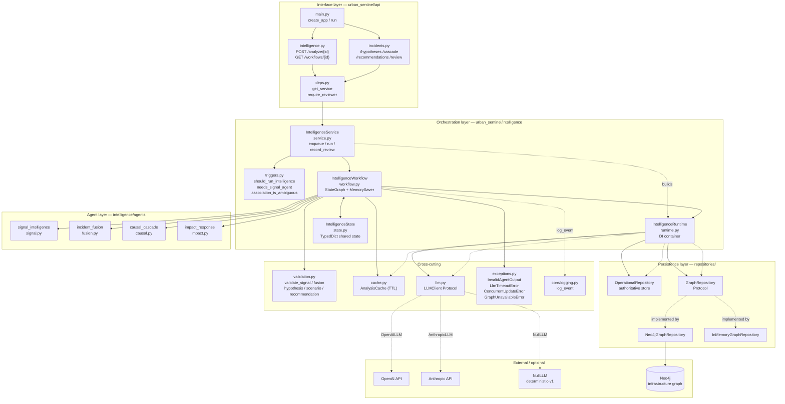
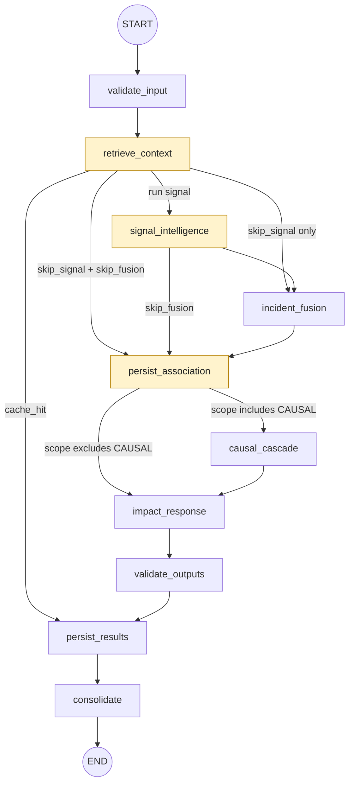
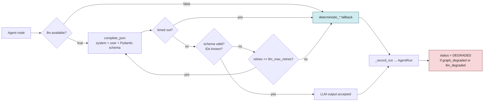
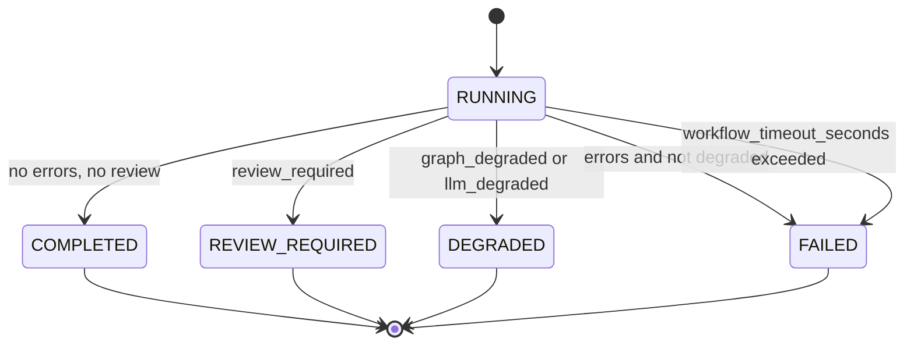

# Urban Sentinel — Multi-Agent System Architecture

Diagrams for the LangGraph-based intelligence layer in `urban_sentinel/`.

## 1. Layered component view



## 2. Workflow state machine

Conditional routing implemented in `_after_retrieve`, `_after_signal`, `_after_persist_assoc`
(`workflow.py:151-168`).



Routing rules:

| From | Condition | To |
| --- | --- | --- |
| `retrieve_context` | `cache_hit` | `persist_results` |
| `retrieve_context` | `skip_signal and skip_fusion` | `persist_association` |
| `retrieve_context` | `skip_signal` | `incident_fusion` |
| `retrieve_context` | default | `signal_intelligence` |
| `signal_intelligence` | `skip_fusion` | `persist_association` |
| `persist_association` | `reanalysis_scope` contains `CAUSAL` | `causal_cascade` |
| `persist_association` | otherwise | `impact_response` |

## 3. Agent call envelope

Every LLM-backed agent shares the same guarded envelope implemented by
`IntelligenceWorkflow._with_retries` (`workflow.py:223-252`). Deterministic
fallbacks make the system run fully offline.



The same envelope runs a second time inside `validate_outputs` (`workflow.py:626`),
which re-validates every persisted artifact against known event / incident / asset /
action IDs before anything is written.

## 4. Full run sequence

```mermaid
sequenceDiagram
    autonumber
    participant C as API client
    participant S as IntelligenceService
    participant W as IntelligenceWorkflow
    participant G as GraphRepository
    participant O as OperationalRepository
    participant L as LLMClient
    participant K as AnalysisCache

    C->>S: analyze(incident_id, scope)
    S->>O: create_workflow(workflow_id)
    S->>S: should_run_intelligence() ?
    alt no material change / anomaly / ambiguity
        S->>O: mark COMPLETED with skip reason
        S-->>C: workflow_id
    else run
        S->>W: ainvoke(payload, workflow_id)
        par parallel evidence fetch
            W->>G: get_incident_evidence
        and
            W->>G: get_incident_graph
        and
            W->>G: get_incident_hypotheses
        and
            W->>G: get_scenarios
        and
            W->>G: get_cascade_paths(max_depth)
        end
        G-->>W: evidence + cascade paths
        Note over G,W: GraphUnavailableError ⇒ graph_degraded,<br/>evidence is NOT fabricated
        W->>K: fingerprint + get(cache_key)
        alt cache hit and not material_change
            K-->>W: cached artifacts; skip signal + fusion
        end
        W->>L: signal agent (JSON)
        L-->>W: SignalAnalysis | deterministic_signal
        loop per trigger event
            W->>L: fusion agent (JSON)
            L-->>W: FusionDecision | deterministic_fusion
        end
        W->>O: attach_events(expected_version)
        O-->>W: ConcurrentUpdateError ⇒ review_required
        W->>G: link_event_to_incident
        W->>L: causal agent (JSON)
        L-->>W: CausalAnalysis | deterministic_causal
        W->>L: impact agent (JSON)
        L-->>W: ImpactAnalysis | deterministic_impact
        W->>W: validate_outputs — re-check all IDs
        W->>O: replace_hypotheses / scenarios / recommendations
        W->>G: upsert_hypothesis / scenario / agent_run
        W->>K: put(cache_key, artifacts)
        W->>O: save_workflow(final state)
        W-->>S: IntelligenceState
        S-->>C: workflow_id (status pollable)
    end
```

## 5. Degradation and status semantics

`consolidate` (`workflow.py:704-716`) resolves the terminal status.



Design invariants visible in these diagrams:

- The graph is **evidence only**. `link_event_to_incident` never invents asset edges, and a Neo4j outage yields empty evidence rather than fabricated evidence.
- The operational repository is authoritative for association, not the fusion agent.
- Confidence stays decomposed — event validity, association score, hypothesis support, severity, and cascade score are never collapsed into one number.
- `impact_response` ranks catalogue actions only; it never computes safety-critical scores and never dispatches. Human approval stays outside the graph.