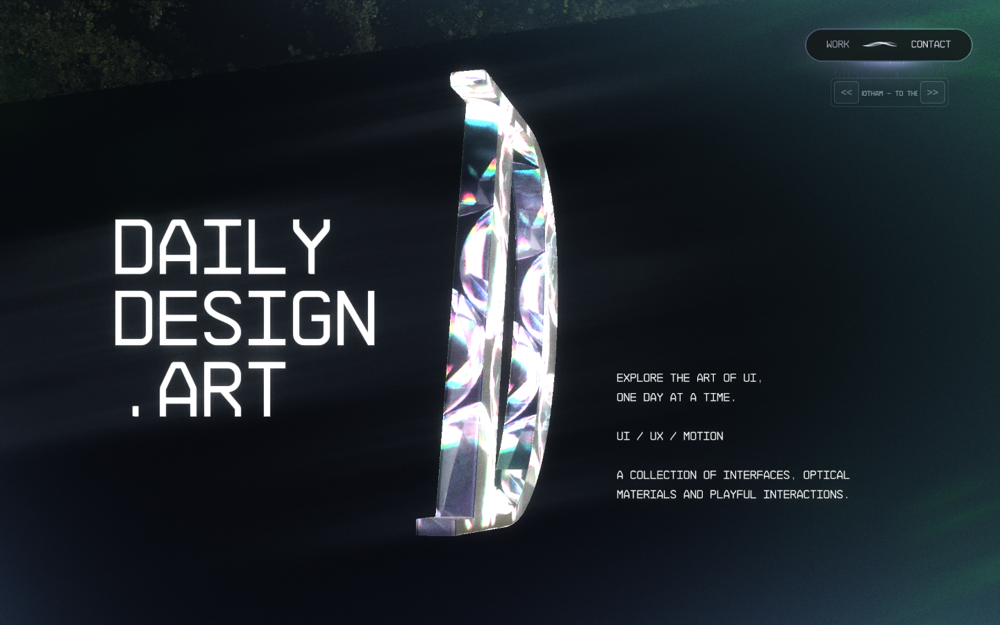
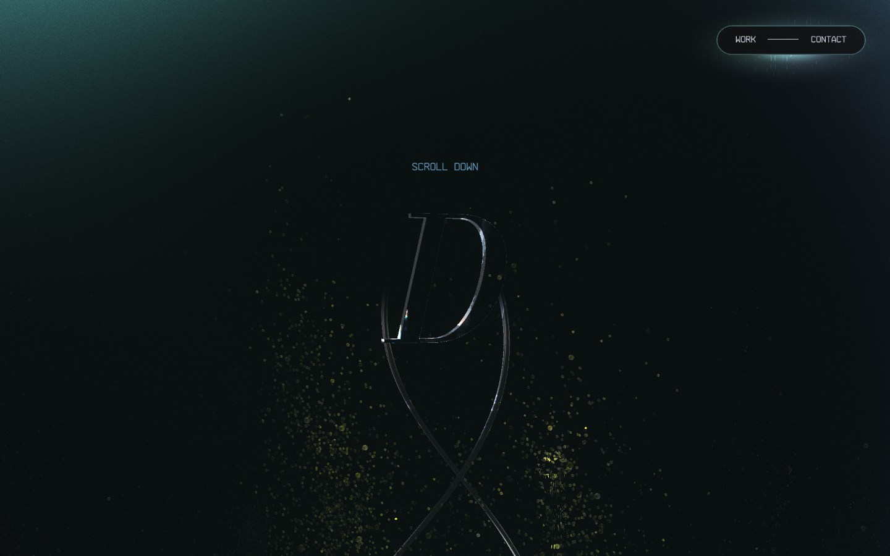
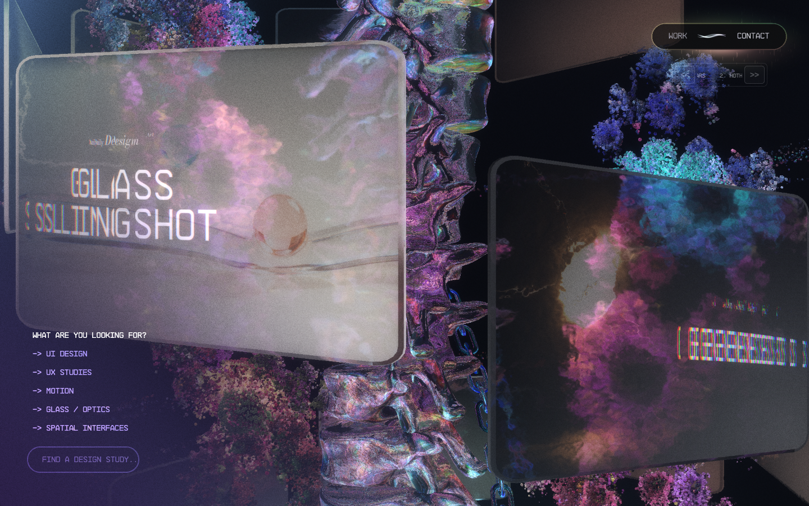
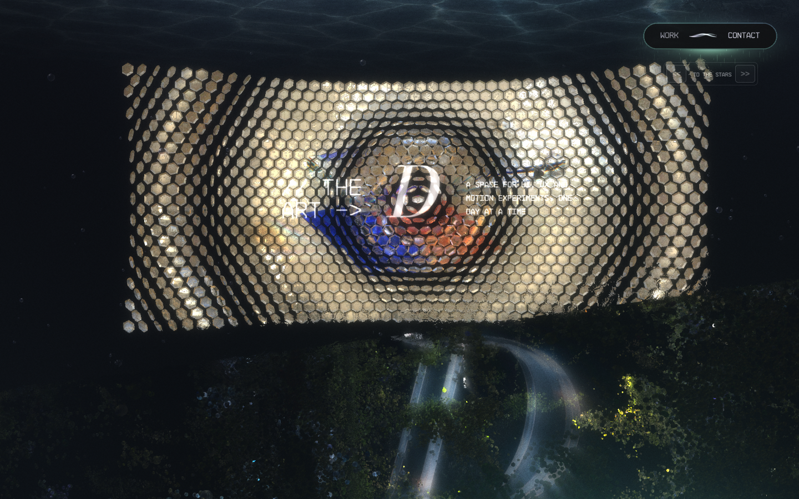
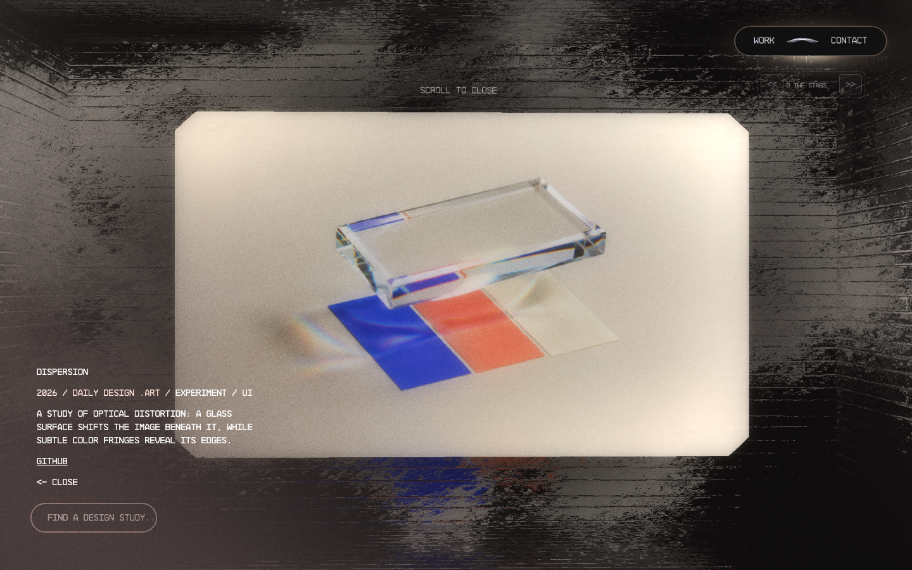
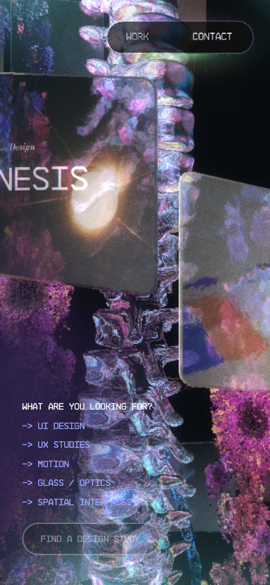
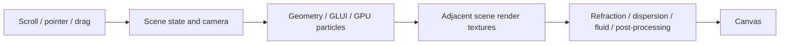

<div align="center">

<h1>Open Active Theory</h1>

<p><strong>Daily Design .Art · WebGL interactive storytelling and optical design experiments</strong></p>
<p>Explore the art of UI, one day at a time.</p>

<p>
  <a href="https://github.com/Snychng/open-active-theory/actions/workflows/check.yml"></a>
  
  
</p>

<p>
  <a href="#quick-start">Quick Start</a> ·
  <a href="#preview">Preview</a> ·
  <a href="#technical-implementation">Technical Implementation</a> ·
  <a href="#custom-content">Custom Content</a> ·
  <a href="#development-and-validation">Development and Validation</a>
</p>

</div>



Open Active Theory is a **Daily Design .Art brand website** that can be cloned, built, and run independently. The project is based on the public Hydra/WebGL release from [Active Theory](https://activetheory.net/), replacing the brand, models, works, and media with original UI/UX design research while preserving the original scenes, camera paths, particles, fluid effects, glass refraction, and interaction mechanisms.

Source code, the build baseline, and runtime assets are all included in the repository. The project does not require API keys, an online CMS account, adjacent workspace dependencies, or system fonts.

## Project Highlights

- **Six continuous scenes**: Home, About, Work, TreeScene, CleanRoom, and Footer, driven by scroll and adjacent scene transitions.
- **Real-time optical materials**: refraction, dispersion, fluid disturbance, particles, bloom, and glow combine to create the WebGL visual language.
- **Complete work interactions**: 14 UI/UX studies with a work wall, tag filtering, local search, detail expansion, full-screen images, and deep links.
- **Original brand geometry**: a real 3D model built from the italic D letterform outline, adapted to different scene sizes and materials.
- **Maintainable content adaptation layer**: brand and project content are centrally configured, and the build validates core visual modules, scene parameters, and GLSL baselines.
- **Desktop and mobile layouts**: preserves the original responsive branches, touch interactions, music controls, and dual-end room sync protocol.

## Quick Start

### Urban Sentinel intelligence workflow

The `/kitchen` operations floor polls `/api/v1/intelligence/workflows/latest` and displays the
Signal Intelligence, Incident Fusion, Causal & Cascade Analysis, and Impact & Response specialist
runs and outputs. Start the Urban Sentinel API alongside this site (default `http://127.0.0.1:8000`);
set `API_ORIGIN` when it runs elsewhere, for example `API_ORIGIN=http://127.0.0.1:8001`.

### Requirements

- **Node.js 20 or newer**; Node.js 22 is recommended to match the CI environment.
- **npm** for installing dependencies from `package-lock.json`.
- A browser with WebGL support; final visuals and performance depend on hardware acceleration, GPU tier, and viewport.

### Clone and Run

```bash
git clone https://github.com/Snychng/open-active-theory.git
cd open-active-theory
npm ci
npm run build
npm run dev
```

Then open **[http://localhost:4199/](http://localhost:4199/)**. Press `Ctrl+C` in the running terminal to stop the service.

On macOS / Linux you can set a different port:

```bash
PORT=4200 npm run dev
```

Both `npm run dev` and `npm start` start the Node.js service. After modifying content or build scripts, run `npm run build` and refresh the page; the current dev server does not provide hot reload.

The service also hosts static assets, deep links, local search, and WebSocket communication. For a complete runtime, use the Node.js entry points above; hosting only `public/` provides static assets but not search and sync capabilities.

## Preview

The following are actual runtime screenshots of the current site, captured on 2026-10-03. The desktop viewport is **1440 × 900** and the mobile viewport is a simulated **390 × 844** browser; the static screenshots show the scene appearances, while the full animation and interactions should be experienced locally.

| Hero · D model and particles | Work wall · spiral layout and refractive cards |
| --- | --- |
|  |  |

| Optical experiments · hexagonal space | Project details · static cover and content |
| --- | --- |
|  |  |

<details>
<summary><strong>View the mobile work wall</strong></summary>

<p></p>

</details>

See [display resource notes](docs/images/README.md) for screenshot sources, capture conditions, and update methods.

## Technical Implementation

### Tech Stack

| Layer | Technology | Responsibility |
| --- | --- | --- |
| Web runtime | JavaScript, Hydra, GLUI | Scene lifecycle, state, cameras, render scheduling, text, and interaction |
| Real-time rendering | WebGL, GLSL | Optical materials, GPU particles, fluids, offscreen textures, and post-processing |
| Content and configuration | ES Modules, UIL, JSON | Brand, works, scene config, and asset mapping |
| Asset generation | Three.js, opentype, Sharp | D model, font outlines, monogram textures, and icon generation |
| Local service | Node.js HTTP, ws | Asset serving, Range support, deep links, work queries, and room sync |
| Engineering validation | Playwright, Node.js assert, GitHub Actions | Asset and parameter validation, desktop/mobile interaction checks, and CI |

**Three.js is used to build the brand geometry; browser scene rendering is still handled by Hydra.** `opentype` is used through the Three.js bundle module, and the dependency version is locked in `package-lock.json`.

### 1. Scene and Rendering Pipeline



`FXScroll` maps scroll position to scene progression, camera placement, and transition states. Adjacent scenes use render textures in compositing to preserve the original site’s bevels, occlusion, and optical transitions. The page follows this configuration order:

| Scene | Original `vh` config | Content and visual treatment |
| --- | --- | --- |
| Home | 4 | Draggable D, particles, and double helix |
| About | 1 | Brand text, slogan, and refractive D |
| Work | 10 | 14 studies, spiral work wall, and details |
| TreeScene | 2 | Brand model and particle scene |
| CleanRoom | 1.2 | Hexagonal optical space and experiment content |
| Footer | 4 | Closing scene and brand convergence |

`vh` is the original engine scene configuration value; the actual height and visible range are computed by the scroll controller and responsive layout. The core implementation can be read starting from [FXScroll](vendor/activetheory/modules/122-FXScroll.js) and the [original published configuration](vendor/activetheory/uil.1780406240914.json).

### 2. Glass, Particles, and Pointer Fluid

The glass material samples the scene texture in GLSL and combines refraction, dispersion, normals, and pointer disturbances to generate optical variation. GLUI and the font atlas carry most scene text, while search inputs and some controls are rendered in the DOM.

[Fluid](vendor/activetheory/modules/117-Fluid.js) uses velocity, dye, pressure, and other offscreen buffers to perform curl, vorticity, divergence, pressure solve, and advection. [MouseFluid](vendor/activetheory/modules/179-MouseFluid.js) injects pointer displacement and velocity into the flow field for material sampling. Particle scale, DPR, frame rate, and post-processing are selected by the original GPU tier branches, so different devices can produce different frame rates and visual detail.

The optical shaders, environment textures, and non-content material parameters continue to follow the original published baseline; build and validation check the original GLSL fingerprints and non-content configuration fields.

### 3. Content Adaptation and Build

[scripts/build.mjs](scripts/build.mjs) builds the branded site from the saved published baseline:

1. Reads `src/content.mjs`, fonts, outlines, monogram assets, and cover art.
2. Replaces brand, work, link, and media content in dedicated modules and UIL fields; it throws immediately if a matching adaptation point is not found.
3. Generates HTML, CMS JSON, icons, textures, and 3D geometry into `public/`.
4. Verifies **15 core visual modules**, the original scene order, and GLSL while recording permissible content replacement fields.

The validation script compares configuration field by field: currently **2578 non-content UIL fields** remain unchanged, while brand, text, model, and media fields are tracked separately. The build record is saved to `.artifacts/adaptation-manifest.json` to trace adaptation points and asset fingerprints.

### 4. Brand D Model

The 3D D is derived from the contours and holes in `src/assets/monogram-shape.json`. The build uses Three.js `Shape`, `Path`, and `ExtrudeGeometry` to extrude, bevel, center, and compute normals, then generates the geometry needed for Home, TreeScene, and the particle scenes.

The model matches the original geometry’s proportions, depth, and center conventions; the external position, rotation, camera, material, and interactions continue to follow the original configuration. Bodoni Moda is used for the D artwork, and a pre-generated monogram SVG avoids system font dependence.

### 5. Static Covers and Work Interaction

Work media uses JPEG covers and continues to use the original `VideoTexture` interface, while adding the dynamic `src` and visibility lifecycle for images. Each work has an independent media URL; when a cover is reused, it can fade in based on the active card.

The work wall preserves the camera path, hover states, and filtering flow. Details keep the expand/exit behavior, text, and particle animation, while full-screen media shows the current project image. The generated site contains 14 original experiments or clearly labeled concept studies.

### 6. HTTP, Search, and Dual-Endpoint Sync

[scripts/server.mjs](scripts/server.mjs) provides the running service for the project:

- Static files, correct resource MIME types, and HTTP Range support.
- Page fallback for deep links such as `/work/dispersion`.
- A local query protocol at `/api/assistant/*` that matches keywords against work names, tags, and descriptions, with partial Chinese keyword mapping.
- A `/ws` room protocol for creating/joining rooms, member state tracking, message broadcast, and interaction data sync.
- `/__health` service and missing resource statistics.

Search workers and sync rooms live in process memory and reset when the service restarts. This provides local keyword search and room services; the original site’s private AI and remote backend are not included in this repository.

## Project Structure

```text
open-active-theory/
├── src/
│   ├── content.mjs              # Brand, slogan, links, and 14 studies
│   └── assets/                  # Fonts, outlines, monograms, and cover inputs
├── vendor/activetheory/          # Published baseline, modules, UIL, and source logs
├── public/                      # Generated site and required runtime assets
├── scripts/
│   ├── build.mjs                # Content adaptation, geometry, and material generation
│   ├── server.mjs               # HTTP, search, and WebSocket
│   ├── check.mjs                # Module, parameter, asset, and service validation
│   ├── verify*.mjs              # Browser, sync, music, and media validation
│   └── test.mjs                 # Build, temporary service, and full validation entry
├── docs/images/                 # Selected README screenshots
├── .github/workflows/check.yml  # GitHub Actions
├── AGENTS.md                    # Project maintenance conventions
└── THIRD_PARTY_NOTICES.md       # Third-party source and license notices
```

`node_modules/` and `.artifacts/` are not committed to Git. Other prototypes, research recordings, social cover artwork, and platform request logs from the original workspace also remain outside this repository.

## Custom Content

| Content to modify | Edit entry |
| --- | --- |
| Brand, slogan, GitHub, work names/descriptions/tags | [src/content.mjs](src/content.mjs) |
| Cover and background images | [src/assets/covers/](src/assets/covers/) and the media mappings in project configs |
| D outline, monogram, and font | [src/assets/](src/assets/) |
| Content adaptation and geometry generation rules | [scripts/build.mjs](scripts/build.mjs) |
| Server-side query and sync protocol | [scripts/server.mjs](scripts/server.mjs) |

After modifying the inputs, run:

```bash
npm run build
```

Brand and work edits are centralized in `src/` and the build adaptation layer; `public/` stores generated files and the next build rewrites them. For changes beyond content—such as camera, material, or motion updates—you must compare against the baseline and run the relevant validation to avoid turning brand adaptation into an implicit animation rewrite.

## Development and Validation

### Full Check

```bash
npx playwright install chromium
npm test
```

`npm test` automatically builds the site, starts a random port, runs asset and service validations, and checks the six scenes, drag actions, details, contact panel, filtering, search, and media activation on desktop and simulated mobile views before shutting the test server down.

If Google Chrome is already installed locally, you can run:

```bash
PLAYWRIGHT_CHANNEL=chrome npm test
```

### Targeted Checks

First run `npm run build` and `npm run dev`, then execute the following in another terminal:

| Command | Checks |
| --- | --- |
| `npm run check` | Core modules, UIL, GLSL re-read, assets, deep links, Range, and search |
| `npm run verify` | Desktop/mobile scenes, transitions, drag, details, filtering, and search |
| `npm run verify:media` | Current card media activation at four Work positions |
| `npm run verify:sync` | Room entry, scroll, and contact panel sync across two browser contexts |
| `npm run verify:music` | Music initialization, toggle, track change, and playback state |

The browser-based commands require Playwright Chromium or the `PLAYWRIGHT_CHANNEL=chrome` override. For non-default ports you can use `PREVIEW_URL`:

```bash
PREVIEW_URL=http://localhost:4200 npm run verify
```

### CI and Reporting

[GitHub Actions](https://github.com/Snychng/open-active-theory/actions/workflows/check.yml) runs the full validation on Ubuntu, Node.js 22, and Playwright Chromium. CI uses Xvfb and Mesa software OpenGL to provide the WebGL context while retaining the original site’s SwiftShader device detection. Asynchronous filtering and media fade-ins wait for actual completion states; if a check fails, the diagnostic JSON is uploaded.

Reports and captured screenshots are stored in `.artifacts/`. The complete verification includes browser and media checks; sync and music are separate targeted commands. Engineering checks, static screenshots, real-device operation, and user visual acceptance are recorded separately and cannot replace one another.

## Known Boundaries

- The original site’s private AI, backend, and cloud sync services are not included in the repository; the local query and room protocols have a clearly defined replacement scope.
- The published baseline includes missing assets such as `lab.gif` and `damaged_road_normal.jpg`, which are still handled by the original renderer fallback; the validation retains these known missing items.
- Random particles, GPU tier differences, frame rate, font content, and custom model outlines can produce visual variation. Matching modules and parameters does not guarantee identical pixels on every frame.
- Browser-simulated mobile layout checks do not replace real-device validation; automated music-state checks do not confirm speaker output has been physically measured.

## Contributing

We welcome issues or improvement suggestions through [Issues](https://github.com/Snychng/open-active-theory/issues). When reporting visual or interaction problems, include the browser, GPU, viewport, reproduction steps, and any relevant screenshots. When submitting code changes, describe the behavior change and run the relevant validation.

See [AGENTS.md](AGENTS.md) for maintenance conventions, and [.agents/notes](.agents/notes/README.md) for existing implementation trade-offs. New assets must document their source; sensitive information, account files, and full test artifacts must not be added to the repository.

## Sources and Licensing

This project is based on the public Active Theory release **`1780406240914`**, with a snapshot date of **2026-09-30**. Runtime code, shaders, scene parameters, some models, textures, font atlases, and music retain their own source and copyright notices; this repository does not attach a single unified MIT license to the full published package.

- Source and dependency notes: [THIRD_PARTY_NOTICES.md](THIRD_PARTY_NOTICES.md)
- Published source, fingerprint, and credential removal record: [vendor/activetheory/SOURCE.json](vendor/activetheory/SOURCE.json)
- Bodoni Moda font license: [SIL Open Font License](src/assets/OFL.txt)

The Daily Design .Art brand content, D geometry, monogram, and cover adaptation are provided by this project. The works are original experiments or concept studies.
